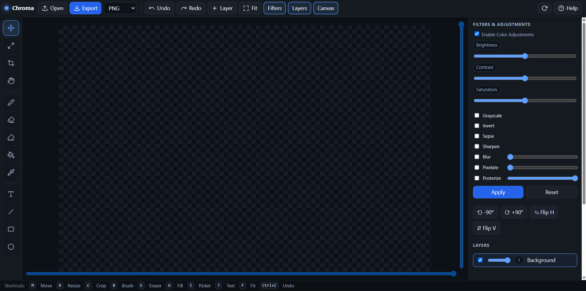

# Chroma — Browser-Based Raster Graphics & Layer Editor


**Chroma** is a lightweight, zero-dependency raster image editor running entirely in the browser. Inspired by desktop tools like Photoshop, it implements multi-layer compositing, pixel-level image filters, custom convolution kernels, and a snapshot-based undo/redo engine from scratch using **Vanilla JavaScript** and the **HTML5 Canvas 2D API**.

**Live Demo:** `https://xdennis090.github.io/chroma-editor/`



---

## Key Features

### Layer Management & Compositing
* **Multi-Layer Architecture:** Create, duplicate, reorder, rename, toggle visibility, and adjust per-layer opacity.
* **Dedicated Ink Overlay:** Freehand brush and ink-eraser strokes automatically target a separate overlay layer to keep underlying photo layers intact.
* **Spatial Transformations:** Move (`M`), interactively resize with aspect-ratio locking (`R` + `Shift`), rotate (±90°), flip horizontally/vertically, and crop (`C`) the canvas.

### Non-Destructive Real-Time Filters & Pixel Operations
* **Color Adjustments:** Real-time brightness, contrast, and saturation sliders via direct `ImageData` buffer manipulation.
* **Convolution Kernels:** Custom 3×3 matrix convolution engine powering multi-pass Gaussian-style **Blur** and **Sharpen** filters.
* **Stylistic Filters:** Grayscale, Invert, Sepia, nearest-neighbor **Pixelate**, and color-quantized **Posterize** effects.
* **Live Preview Workflow:** All filter changes preview non-destructively on a temporary offscreen buffer until committed with **Apply** or discarded via **Reset**.

### Drawing & Selection Tools
* **Brushes & Erasers:** Adjustable brush size, radial-gradient edge hardness, and opacity (`B`, `E`), plus a hard ink eraser.
* **4-Way Flood Fill:** Stack-based contiguous bucket fill (`G`) operating directly on RGBA pixel arrays.
* **Vector-Style Primitives & Text:** Configurable stroke/fill shapes (Line `L`, Rectangle `Q`, Ellipse `S`), custom typography (`T`), and a composite Eyedropper (`I`).

### Workspace & Export
* **Smooth Viewport Navigation:** Mouse-wheel zooming centered on the cursor, pan sliders, Hand tool (`H`), and one-click Fit-to-Screen (`F`).
* **Undo / Redo History:** 50-step snapshot history (`Ctrl+Z` / `Ctrl+Y`).
* **Multi-Format Export:** Flatten and export compositions as **PNG**, **JPEG** (with adjustable compression quality and custom background fill), or **WebP** (`Ctrl+S`).
* **Drag & Drop Import:** Open local images via file picker (`Ctrl+O`) or drag and drop files directly onto the stage.

---

## Project Structure

```text
chroma-editor/
├── assets/
│   └── screenshots/
│       └── preview.png   # Application preview screenshot
├── css/
│   └── styles.css        # Dark UI layout, CSS Grid workspace, and modal styles
├── js/
│   └── app.js            # Core state, rendering pipeline, tools, filters, and history
├── .gitignore
├── index.html            # Main application shell & inline SVG iconography
├── LICENSE
└── README.md
```

---

## Getting Started

Because Chroma uses zero external libraries or build tools, you can run it immediately in any modern browser:

### Option 1: Local HTTP Server (Recommended)
Running via a local server avoids browser `file://` security restrictions when manipulating `ImageData`:

```bash
# Clone the repository
git clone https://github.com/xdennis090/chroma-editor.git
cd chroma-editor

# Start a local server with Python
python -m http.server 8000
```

Then open `http://localhost:8000` in your browser.

### Option 2: Direct Browser Launch
Simply double-click `index.html` to open the editor offline.

---

## Keyboard Shortcuts

| Key | Action | Key | Action |
| :--- | :--- | :--- | :--- |
| `M` | Move Layer | `I` | Eyedropper |
| `R` | Resize / Transform (`Shift` = Lock Aspect Ratio) | `T` | Text Tool |
| `C` | Crop Selection | `L` / `Q` / `S` | Line / Rectangle / Ellipse |
| `H` | Hand (Pan Viewport) | `F` | Fit Canvas to Screen |
| `B` | Brush | `Ctrl + Z` / `Y` | Undo / Redo |
| `E` | Eraser | `Ctrl + O` / `S` | Open / Export Image |
| `G` | Flood Fill Bucket | `F1` | Toggle Quick Guide |

---

## License

This project is licensed under the MIT License — see the [LICENSE](./LICENSE) file for details.